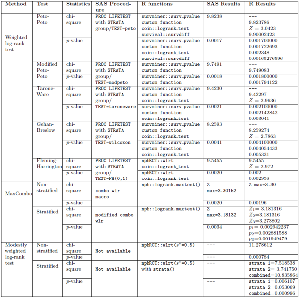

A recent CAMIS contribution explored the implementation of weighted log-rank tests in R and SAS. Weighted log-rank tests are non-parametric methods for comparing survival curves. They are mainly utilized in studies with non-proportional hazards. The explored and often used weighted log-rank tests are Peto-Peto, modified Peto-Peto, Tarone-Ware, Gehan-Breslow/Wilcoxon, and Fleming-Harrington. All of these differ on whether more weight is assigned to earlier or later events. Other weighted log-rank tests explored are MaxCombo and the modestly weighted log-rank test. The MaxCombo test method combines several weighted log-rank statistics to enhance sensitivity to non-proportional hazards. The modestly weighted log-rank test is suitable for delayed effects. The table below highlights the R packages and functions, as well as SAS procedures, used to perform these tests, along with their results on example data.

The [custom R function](https://github.com/kassambara/survminer/blob/master/R/weighted_logrank.R) referenced in the table above is an internal implementation of the procedures provided by the *survminer* package. The [CAMIS website](https://psiaims.github.io/CAMIS/R/Weighted-log-rank.html) illustrates the function\'s implementation. Earlier versions of *survminer* relied directly on functions from the *survMisc* package. Now, *survminer* developers removed the external dependency and implemented the weighted log-rank test procedures internally within the package. The custom R function can generate both the p-values and the chi-square test statistics (*surviminer::surv_pvalue* only generates the p-value).

The SAS LIFETEST procedure does not have a built-in functionality to perform the MaxCombo test. This test is enabled by the [combo wlr SAS macro](https://github.com/dreaknezevic/combo-wlr). For the stratified and non-stratified case, check the [CAMIS website](https://psiaims.github.io/CAMIS/SAS/weighted_logrank_test.html). Also, according to our knowledge, the SAS LIFETEST procedure currently lacks built-in functionality for the modestly weighted log-rank test.

Based on the tabled results, the level of agreement between R and SAS results depended on the R function used. For example, the three major R functions implementing Peto-Peto versions produced different results:

-   *survminer::surv_pvalue* and the custom function results were comparable to PROC LIFETEST results.

-   The results from the *survival::survdiff* function were close but not identical to those from PROC LIFETEST. Their weighting functions are not the same.

-   The *coin::logrank* test function had the most different results. This is because the coin package provides inference within the permutation test framework.

Under the MaxCombo test, both the R and SAS implementations use asymptotic multivariate normal approximations, but they differ in how they numerically evaluate the MaxCombo p-values (quasi-Monte Carlo integration vs. Monte Carlo integration), which influences the computation of multivariate normal probabilities. In the stratified case, R implements three stratification approaches (***U, Z,*** and ***N***-statistic scales), whereas SAS produces a single stratified MaxCombo result. See full details on the [comparison between R and SAS here](https://psiaims.github.io/CAMIS/Comp/r-sas%20weighted%20logrank.html).

The CAMIS open-source repository aims to provide vital information about the application of statistical methodology in various software (including SAS, R and Python). By documenting found differences in a repository, we aim to reduce time-consuming efforts within the community, where multiple people are investigating the same issues. As a group effort, the repository will continue to grow in content and be a vital source for medical statisticians and programmers. See [CAMIS - A PHUSE DVOST Working Group](https://psiaims.github.io/CAMIS/) for the repository or how to [[Get Involved.]{.underline}](https://psiaims.github.io/CAMIS/contribution/contribution.html)
